# codex-to-wechat

面向本地个人工作流的 Python 自动化实验项目，包含每日计划草稿状态机、Web-first 已确认计划投递、iLink 收发适配、路线复盘同步、Shared State 导出，以及一个带人工审核边界的 Chat Agent 原型。

这个仓库当前是**开源发布准备快照**，不是即插即用的微信机器人发行版。默认演示和测试均使用 Mock，不连接微信、Google Drive、Ollama 或个人数据。真实 iLink、Windows DPAPI、DriveFS 与任务计划程序属于实验性、环境相关集成；本次发布准备没有运行它们，也没有声称它们在干净机器上已端到端复现。

## 快速开始

需要 Python 3.10 或更新版本。运行时与测试代码仅使用 Python 标准库。

```powershell
python --version
python examples/mock_delivery_demo.py
python daily_plan_mock/scripts/run_demo.py
python -m unittest discover -s . -p "test_*.py" -v
```

Web-first 演示使用临时目录中的样例 JSON、SQLite 幂等账本和假传输器，输出应显示首次结果 `DELIVERED`、重复执行 `NOOP`、假传输调用一次、网络访问为 `NO`。旧版每日计划演示也只使用内存 SQLite 与 `MockTransport`。

## 项目包含什么

- **每日计划状态机**：输入、草稿、精确确认与本地 Mock 投递；用于验证流程，不代表真实微信运行。
- **Web-first Delivery**：读取明确 Inbox 中的 `CONFIRMED` JSON，严格校验、规范化 hash、目标日期筛选、冲突拒绝和幂等账本，再交给传输接口格式化投递。
- **安全边界组件**：iLink receive/parser、白名单与指纹校验、重复消息抑制、DPAPI Current User 凭据封装、短期 Reply Context、Session Health 状态与锁。
- **Roadmap / Review Sync**：结构化 Review Update 校验、幂等导入和下一可执行任务投影。发布副本只带示例路线，不带维护者个人的进度状态。
- **Shared State**：已确认计划与 Roadmap 投影的 JSON/Markdown 导出，以及限定文件名的本地同步适配器。
- **Chat Agent 原型**：消息分类、联系人配对、审核优先策略、草稿和传输接口。自动发送不是默认路径。

这些能力是同一仓库内的模块集合，不是一个已经打包、版本化并具备统一稳定 API 的 Python SDK。模块之间仍有紧密的仓库内导入关系。

## 架构

```mermaid
flowchart LR
  Web[ChatGPT Web / 人工确认] --> JSON[Confirmed Delivery JSON]
  JSON --> Inbox[Delivery Inbox scanner]
  Inbox --> Validate[Schema validation + normalized hash]
  Validate --> Select[Target-date and conflict selection]
  Select --> Ledger[Idempotency ledger]
  Ledger --> Format[Deterministic formatter]
  Format --> Transport[Transport interface]
  Transport --> Mock[Mock transport: default demo]
  Transport --> Ilink[Experimental iLink adapter]

  Updates[Review Update JSON] --> Review[Review Inbox validation]
  Review --> Store[RoadmapProgressStore]
  Store --> Source[Roadmap task source]
  Source --> Recommend[Recommendation / fusion modules]
  Recommend --> Web

  Plan[Confirmed plan snapshot] --> Export[Shared State exporter]
  Store --> Export
  Export --> Files[JSON + Markdown]
  Files --> Sync[Allowlisted local sync adapter]

  Ilink --> Receive[Receive parser / whitelist / dedupe]
  Receive --> Context[Short-lived protected reply context]
  Receive --> Agent[Chat Agent / planner adapters]
```



Web-first Delivery intentionally starts from an already confirmed plan. It does not invoke the legacy multi-turn planner, Roadmap recommendation, or Fusion chain. Review import is a separate progress-authority path; Delivery JSON itself does not mutate Roadmap or reading progress.

## 配置与运行边界

本地 Mock 不需要配置。`.env.example` 仅是变量名模板，Python 不会自动读取 `.env`；真实环境必须由操作者显式设置变量并核对目录。

| 变量 | 用途 |
| --- | --- |
| `ILINK_STATE_DIR` | iLink 本地 DPAPI 凭据和状态目录；未设置时使用当前用户 Local AppData 下的通用目录 |
| `ILINK_EXPECTED_RECIPIENT_FINGERPRINT` | 经操作者批准的 12 位十六进制收件人指纹；源码不内置个人指纹 |
| `DAILY_PLAN_STATE_DIR` | Production 状态目录；为空时使用 iLink 状态目录下的 `production/daily-plan` |
| `DAILY_PLAN_REVIEW_INBOX` | Review Inbox 的明确绝对路径 |
| `DAILY_PLAN_DELIVERY_INBOX` | Delivery Inbox 的明确绝对路径 |

实时凭据封装依赖 Windows DPAPI Current User。真实微信接入还依赖 iLink 服务与经过授权的账号/收件人绑定；DriveFS 目录必须由用户自行配置和同步。本副本不包含 Task Scheduler 安装器、Production 启动脚本、机器专用试点脚本或重认证提升脚本。低层实验 CLI 仍包含显式 `--live` 操作；这些命令可能访问真实账号或修改本地凭据，默认演示和测试不会调用它们。

不要把 token、cookie、原始收件人 ID、`context_token`、DPAPI 文件、真实计划、SQLite 账本或运行日志提交到仓库。缺少配置时，实时构造路径应失败关闭；不要用占位值冒充可工作的服务配置。

## 目录导览

| 路径 | 用途 |
| --- | --- |
| `daily_plan_mock/` | 本地每日计划状态机和假传输器 |
| `daily_plan_delivery/` | Web-first Delivery schema、formatter、服务与账本 |
| `daily_plan_production/` | 有界 Delivery runtime、状态路径与进程锁（无安装器/启动脚本） |
| `ilink_receive_probe/` | iLink 协议、接收、凭据、身份、会话健康和实验性发送适配 |
| `daily_plan_roadmap/` | 路线定义、进度存储、Review Sync 与任务来源 |
| `daily_plan_recommendation/`, `daily_plan_fusion/` | 推荐评分和计划融合 |
| `daily_plan_shared_state/` | Shared State 导出和 allowlist 同步 |
| `daily_plan_friendly_input/`, `daily_plan_wechat_integration/` | 确定性输入解析和旧流程适配 |
| `chat_agent/` | 审核优先的本地 Chat Agent 原型 |
| `daily_plan_codex_planner/` | Codex planner 协议与隔离边界原型 |
| `examples/` | 人工可识别的示例数据和无网络 Demo |
| `docs/` | 架构、配置、安全和测试说明 |

`examples/roadmap_profile.example.json` 是通用虚构路线，不代表维护者的学习记录。`examples/reading_catalog.example.json` 只含一条“示例书籍”占位记录，供集成测试验证读取流程；它不是书单，使用者应替换成自己的数据。

## 验证范围

测试命令见上方。测试主要覆盖 schema 拒绝、规范化与幂等、失败关闭、状态机、Mock transport、路线同步、Shared State 投影和日志脱敏。默认单元测试不调用真实 iLink 网络；Chat Agent 的本地 review server 测试可能启动 loopback HTTP 服务，不连接外网。

发布准备期间实际在本副本运行的命令和结果会记录在交付报告中。被排除的本机操作脚本、Windows 任务计划程序、DPAPI 实际密文读写、DriveFS 云端传播、真实微信收发和第三方 Ollama 服务不由单元测试覆盖。不能把 Mock 通过等同于真实端到端验证。

## 许可证与第三方来源

项目所有者有权授权的代码按 [MIT License](LICENSE) 发布。iLink 请求结构参考 Tencent `openclaw-weixin` v2.4.8；其来源说明、适用的 Tencent 版权声明和完整 MIT 文本见 [THIRD_PARTY_NOTICES.md](THIRD_PARTY_NOTICES.md)。本项目与 Tencent 无官方认可或合作关系。

## 文档

- [系统架构](docs/architecture.md)
- [开发与配置](docs/development.md)
- [安全说明](SECURITY.md)
- [第三方来源与许可声明](THIRD_PARTY_NOTICES.md)
- [贡献指南](CONTRIBUTING.md)
- [英文 README](README_EN.md)
