# Architecture and data boundaries

```mermaid
flowchart LR
  Web[ChatGPT Web / human confirmation] --> Plan[Confirmed Delivery JSON]
  Plan --> Inbox[Explicit-root Delivery Inbox]
  Inbox --> Validate[Strict schema + normalized hash]
  Validate --> Select[Target date + conflict selection]
  Select --> Ledger[Idempotency ledger]
  Ledger --> Render[Deterministic formatter]
  Render --> Port[Transport interface]
  Port --> Mock[Fake transport]
  Port --> Live[Experimental iLink send adapter]

  ReviewJSON[Review Update JSON] --> ReviewInbox[Review Inbox validator]
  ReviewInbox --> Roadmap[RoadmapProgressStore]
  Roadmap --> Tasks[RoadmapTaskSource]
  Tasks --> Recommend[Recommendation and fusion]

  Plan --> Export[Shared State exporter]
  Roadmap --> Export
  Export --> Shared[JSON and Markdown]
  Shared --> Sync[Allowlisted local file sync]

  Live --> Receive[iLink receive/parser]
  Receive --> Identity[Whitelist, fingerprint, dedupe]
  Identity --> Context[Short-lived protected reply context]
  Identity --> Agent[Chat Agent and planner adapters]
```

## Separation of authority

- A Delivery plan is read-only input to the delivery service. Validation and formatting do not update Roadmap or reading progress.
- A Review Update is the explicit input to `review_sync`; successful import writes to the selected Roadmap store and its review ledger.
- A Shared State export is a projection of confirmed plans and Roadmap/review state. Sync only applies an allowlist to the two Shared State filenames.
- The legacy interactive planner, the Web-first Delivery service, Roadmap progress, Reading catalog, and Chat Agent each have separate stores/adapters. They are not a single universal state machine.

## Delivery sequence

1. Scan only the configured Delivery Inbox root.
2. Parse and validate the strict schema; reject unknown and unsafe fields.
3. Select the requested target date and fail closed on multiple/conflicting candidates.
4. Hash the normalized payload and consult the plan ledger.
5. Run optional session preflight and, where configured, require a fresh accepted inbound context.
6. Format deterministically, call the injected transport once, and record a closed result. `FAILED`/`UNKNOWN` are not silently retried.

The fake-transport demo exercises this service without constructing a real iLink client.

## iLink and Chat Agent

Transport objects are explicit dependencies; importing a module does not itself send. Network activity occurs only when a live method is called. Raw credentials and reply context are intended to stay inside dedicated storage/transport boundaries. The low-level CLI includes explicit live operations; the public-prep docs do not present those operations as a safe onboarding path.

## Runtime assumptions

- Python 3.10+ for typed Python modules and `zoneinfo`.
- Windows is required for DPAPI Current User and the omitted Task Scheduler/DriveFS machine operations.
- Google Drive for Desktop and iLink are external services, not Python dependencies.

The iLink request-shape reference used for interoperability is Tencent
[`openclaw-weixin` v2.4.8](https://github.com/Tencent/openclaw-weixin/tree/v2.4.8).
See [Third-party notices](../THIRD_PARTY_NOTICES.md) for its copyright and
license text. This project is not endorsed by or affiliated with Tencent.
- An Ollama-compatible local service is optional for the Chat Agent; no Python Ollama client package is required.
- The project does not yet ship a unified package installer or stable SDK boundary.
